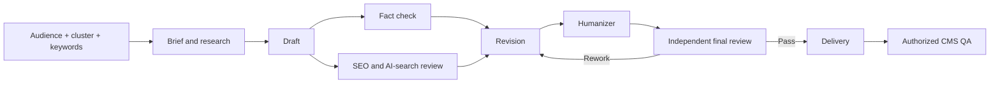

<h1 align="center">WordPress Content Skills</h1>

<p align="center">
  <strong>Turn a content brief into a sourced, reviewed WordPress article.</strong><br>
  Research, drafting, fact-checking, SEO / GEO review, human editing, and a publish-ready package.
</p>

<p align="center">
  <a href="https://github.com/METAXGTSEOSEM/wordpress-content-skills/releases">
    
  </a>
  <a href="LICENSE">
    
  </a>
  <a href="https://github.com/METAXGTSEOSEM/wordpress-content-skills/actions/workflows/validate.yml">
    
  </a>
</p>

<p align="center">
  <a href="#quickstart">Quickstart</a> ·
  <a href="examples/project-management-tool-article/README.md">See a full example</a> ·
  <a href="#workflow-catalog">Workflows</a> ·
  <a href="#installation">Install</a> ·
  <a href="docs/compatibility.md">Compatibility</a> ·
  <a href="docs/faq.md">FAQ</a> ·
  <a href="CHANGELOG.md">Changelog</a> ·
  <a href="CONTRIBUTING.md">Contribute</a>
</p>

<p align="center">
  <strong>⭐ Star this repository</strong> to follow releases, or share it with
  WordPress, SEO and GEO people who write a lot of product-led content.
</p>

<p align="center">
  
</p>

---
WordPress Content Skills provides evidence-based article writing and review for
WordPress websites. The released article workflow covers research, drafting,
fact-checking, SEO content review, and generative engine optimization (GEO) /
AI search considerations.

Product pages, case studies, and UI/UX improvements are planned as separate
modules with their own briefs, review criteria, and deliverables. They are not
included in the current release.

**Current release:** `1.5.0` · **Available modules:** `1` · **License:** MIT

**Repository:** [METAXGTSEOSEM/wordpress-content-skills](https://github.com/METAXGTSEOSEM/wordpress-content-skills).
The article Skill keeps its existing ID, `independent-site-article`, and is now
version `1.3.0`.

The workflow produces a manuscript and WordPress publishing fields. It runs in
a compatible agent host; it is not a WordPress plugin. CMS access and publishing
authorization are separate.

## What you get

- A researched, evidence-based draft in the requested language.
- A visible review decision: `PASS`, `REWORK` or `BLOCKED`.
- Source and claim records, including missing evidence.
- A cluster map, keyword plan and cannibalization check.
- H1, SEO title, meta description, slug, excerpt, image notes and internal-link
  suggestions.
- A recommended article length and image count with a rationale, not a fixed quota.
- An image plan with purpose, placement, caption, alt text and rights status.
- A WordPress field pack and publishing checklist.
- A separate technical status: `TECH_PASS`, `TECH_REWORK` or `TECH_NOT_CHECKED`.

`PASS` confirms the editorial workflow completed. It does not mean the page has
been published, indexed, ranked or cited by an AI search service.

## Choose the article type

The Skill selects one primary content type before outlining. The type sets the
reader's job, required sections, evidence priorities, CTA and review gate. It
does not set a fixed word count or keyword density.

| Type | Reader question | What the article must do |
| --- | --- | --- |
| Awareness / education | What is it? | Define the topic, categories and fit before selling. |
| Selection / buying guide | How do I choose? | Turn the decision into criteria, trade-offs and a usable shortlist. |
| Comparison / alternative | X or Y? | Compare like-for-like and state which scenario fits which option. |
| Specification / standard | What must it meet? | State units, versions, test methods and unresolved values. |
| Application / scenario | Is it right for my situation? | Test the option against real constraints and permitted evidence. |
| Troubleshooting / process | How do I diagnose or solve it? | Separate symptoms, causes, checks and safety escalation. |
| Certification / compliance | What does compliance require? | Explain scope, jurisdiction, documents and limits. |
| Procurement / cooperation | How do I buy or qualify a supplier? | Clarify the model, information request and approved commercial terms. |

See [content types and article frameworks](skills/independent-site-article/references/content-types.md)
for required sections, type-specific review gates and guardrails. If the brief
does not name a type, the Skill infers one from the reader's decision stage and
records the assumption.

## Audience, cluster and keyword checks

- The opening and CTA follow the primary reader's role and decision authority;
  procurement, owners and engineers do not get the same article.
- The page must have one cluster role, one primary intent and one focus keyword;
  existing URLs are checked for cannibalization before a new target is assigned.
- If you already have a keyword list, it is used with its source and date. If
  not, the Skill can use DataForSEO when authorized; AI-generated keywords are
  labeled unverified and never presented as measured volume.
- Article length and image count are recommended per article with a rationale.
  There is no universal word count or "one image every N words" rule.

See [cluster and keywords](skills/independent-site-article/references/cluster-and-keywords.md)
and [SEO/GEO delivery](skills/independent-site-article/references/seo-geo-delivery.md).

## Who it is for

- WordPress site owners and editors who publish buying guides or educational content.
- SEO / GEO operators who need a repeatable research, outline and review process.
- People who need a clear article framework for search results and AI-assisted answers, not just a keyword list.
- People who need to place an article within an existing topic structure and verify its internal-link targets.
- People who need a keyword plan with intent and search-volume provenance, not AI-guessed numbers.
- B2B teams preparing quote-request, product-education or comparison pages.
- B2C teams preparing article-led product content.
- Teams with incomplete product knowledge that need missing specifications, evidence and buyer questions surfaced before drafting.
- Writers and editors revising AI-assisted drafts that feel generic, repetitive or over-polished.

It does not replace product, legal or engineering review. It does not invent
missing product facts, guarantee rankings or AI citations, or guarantee a
particular AI-detector result.

Topic-cluster strategy is not yet a separate module. The current workflow helps
define one article's role and verify its internal links; it does not claim to
produce a complete site-wide cluster plan.

## Quickstart

1. Install the complete `skills/independent-site-article/` folder and the
   required Language Editor listed below.
2. Copy the [example brief](examples/project-management-tool-article/brief.md) or write
   your own.
3. Ask the agent:

```text
Use independent-site-article.

Brief: [paste or link your brief]
Market: [country]
Audience role/decision authority: [procurement, owner, engineer, operator, end user]
Business model: [B2B or B2C]
Content type: [if known, or ask the Skill to infer one]
Competitor URL/brand: [optional reference, not a template to copy]
Existing cluster/pages: [sitemap or relevant URLs]
Keyword assets: [list/file or none]
Keyword data: [owner list / DataForSEO / AI hypotheses only]
Image assets: [product, factory, structure, detail, application, none]
Goal: [what the reader should understand or do]
Evidence: [datasheets, first-party material, sources]

Write in English. Research before drafting.
Mark missing product evidence as missing; do not invent it.
Check keyword cannibalization before assigning the focus keyword.
Recommend article length and image count with a reason.
Use humanizer for language editing, then an independent final reviewer.
Deliver the article, cluster map, keyword plan, SEO/GEO sheet, image plan,
source and claim records, review report, and WordPress fields.
Do not upload or publish.
```

No specific model, paid research provider or CMS connection is required.
Missing capabilities limit what can be verified.

## See a full example

The [project management tool example](examples/project-management-tool-article/README.md)
shows the complete handoff:

| Stage | File |
| --- | --- |
| Brief | [brief.md](examples/project-management-tool-article/brief.md) |
| Evidence ledger | [sources.csv](examples/project-management-tool-article/sources.csv) |
| Claim checks | [claims.csv](examples/project-management-tool-article/claims.csv) |
| First draft | [draft-v1.md](examples/project-management-tool-article/draft-v1.md) |
| Review decision | [review.md](examples/project-management-tool-article/review.md) |
| Final article | [final.md](examples/project-management-tool-article/final.md) |
| WordPress fields | [wordpress-fields.md](examples/project-management-tool-article/wordpress-fields.md) |
| Cluster map | [cluster-map.csv](examples/project-management-tool-article/cluster-map.csv) |
| Keyword plan | [keyword-plan.csv](examples/project-management-tool-article/keyword-plan.csv) |
| Image plan | [image-plan.csv](examples/project-management-tool-article/image-plan.csv) |
| SEO/GEO sheet | [seo-geo-delivery.md](examples/project-management-tool-article/seo-geo-delivery.md) |

The example is synthetic and clearly labeled. Do not publish its fictional brand,
placeholders or product details as real claims.

## See a training-manual opening rewritten

The [audience rewrite example](examples/audience-rewrite/README.md) shows the same
generic topic as a textbook-style introduction and as a decision-led opening for
an operations lead. It includes the review findings that explain what changed.

## Workflow catalog

| Workflow | Status | Installable Skill | Scope |
| :--- | :--- | :--- | :--- |
| **Articles** | **Available · v1.3.0** | [`independent-site-article`](skills/independent-site-article/SKILL.md) | Type-aware articles with audience calibration, cluster and keyword planning, cannibalization checks, SEO / GEO delivery, image planning, evidence checks, language editing, and final review. |
| **Product pages** | Planned | Not released | Product specifications, purchase intent, substantiated benefits, comparisons, and conversion review. |
| **Case studies** | Planned | Not released | Customer permission, project evidence, measured outcomes, narrative, and attribution review. |
| **UI/UX improvements** | Planned | Not released | Existing-site audit, page structure, design handoff, responsive behavior, and implementation QA. |

Only **Available** modules can be installed. Planned modules are specifications,
not placeholder Skills. See the [roadmap](docs/roadmap.md) and machine-readable
[catalog](catalog.json).

## Installation

Use your agent host's documented Skill installation method. The source repository is:

```text
https://github.com/METAXGTSEOSEM/wordpress-content-skills
```

1. Download the release ZIP or use a host-supported repository installer.
2. Select only the available article module at `skills/independent-site-article/`.
3. Keep the complete folder, including `SKILL.md`, `references/`, `assets/` and
   `agents/`. Copying only `SKILL.md` leaves required instructions and templates behind.
4. Install the required language editor listed below and make both Skills
   available to the coordinating assistant.
5. Confirm the host can load the Skill and its supporting files before starting
   an article.

For discovery and installation, use only entries marked `available` in
[catalog.json](catalog.json). Planned modules have no installation path.
Installing the article module does not register a fixed set of global subagents.

### Language editing dependencies

| Output language | Required Skill | Source |
| :--- | :--- | :--- |
| English, the default | `humanizer` | [blader/humanizer](https://github.com/blader/humanizer) |
| Chinese, only when explicitly requested | `humanizer-zh` | [op7418/Humanizer-zh](https://github.com/op7418/Humanizer-zh) |

All repository documentation, templates, Skill instructions, and interface
metadata are in English. An explicit article-language request may override the
English output default.

The required editor must actually be available and used. Missing dependencies
are reported; ordinary rewriting is never labeled as a completed Humanizer pass.
Third-party Skill text is not bundled.

## How an article moves through review



| Role | Responsibility |
| :--- | :--- |
| Cluster and keyword planner | Cluster map, cannibalization check, focus and secondary keywords, and internal-link plan. |
| Researcher | Search intent, first-party material, source records, and outline. |
| Writer | Evidence-based drafting and revisions. |
| Fact checker | Claims, figures, specifications, scope, and citations. |
| Search reviewer | Reader intent, SEO, AI-search considerations, and technical unknowns. |
| Language editor | The specified Humanizer, with meaning and sources preserved. |
| Final reviewer | Independent assessment of the exact edited version. |
| Publishing reviewer | CMS and page checks within the authorized scope. |

The coordinator can pass these roles to available general-purpose subagents. A
host without delegation can produce a draft and self-review report, but must mark
independent review as pending.

## WordPress handoff

- [WordPress publishing fields](docs/wordpress-fields.md): H1, SEO title, meta
  description, slug, excerpt, taxonomy, media, schema and B2B/B2C CTA differences.
- [Publishing checklist](docs/publishing-checklist.md): what to verify before,
  during and after publishing.
- [Example field pack](examples/project-management-tool-article/wordpress-fields.md):
  a concrete handoff an editor can review.

The Skill does not write to WordPress by default. A CMS connection, publishing
action or production change requires separate authorization.

## Compatibility and data

- [Compatibility and requirements](docs/compatibility.md): tested and untested
  hosts, optional research, subagent support and review limitations.
- [Data handling and permissions](docs/data-handling.md): what the Skill reads,
  what it writes, and what it does not do by default.
- [FAQ](docs/faq.md): plugin vs Skill, publishing, API keys, languages, SEO
  plugins, missing data and updates.

## Quality boundaries

<details>
<summary><strong>What the workflow will not do</strong></summary>

- Verify current primary sources instead of treating the policy baseline as permanently current.
- Do not invent specifications, testimonials, experience, certifications, statistics, or search data.
- Recheck facts and qualifiers after language editing.
- Do not substitute word-count targets, keyword density, NLP scores, or AI-detector scores for review.
- Keep search-crawler access distinct from model-training permission.
- Require separate authorization for CMS writes, publishing, and production changes.
- Do not promise rankings, indexing, AI citations, or AI-detector results.

</details>

## Project layout

```text
catalog.json                     Available and planned modules
skills/
  independent-site-article/      The installable article workflow
    SKILL.md
    agents/openai.yaml
    references/                  Workflow, content types, audience, cluster/keywords, SEO/GEO and policy sources
    assets/                      Brief, cluster, keyword, image and delivery templates
examples/
  project-management-tool-article/  Complete synthetic article package
  audience-rewrite/                  Training-manual vs decision-led opening
docs/
  architecture.md                Packaging and compatibility rules
  compatibility.md               Host requirements and limits
  data-handling.md               Reads, writes and permissions
  faq.md                         Common questions
  publishing-checklist.md        WordPress pre/post-publish checks
  roadmap.md                     Planned workflow specifications
  wordpress-fields.md            Field mapping and handoff guidance
scripts/
  validate.py                    Catalog, packaging, language, and link checks
```

To add a workflow, follow [CONTRIBUTING.md](CONTRIBUTING.md). Each installable
module must remain self-contained because a host may copy its folder without the
rest of this repository.

Run the library checks with Python 3.9 or later:

```bash
python3 scripts/validate.py
```

## Community and feedback

- Use the [Bug report](.github/ISSUE_TEMPLATE/bug_report.yml) or
  [Feature request](.github/ISSUE_TEMPLATE/feature_request.yml) template.
- Ask usage questions in [Discussions Q&A](https://github.com/METAXGTSEOSEM/wordpress-content-skills/discussions/categories/q-a).
- Share a redacted output in [Show and tell](https://github.com/METAXGTSEOSEM/wordpress-content-skills/discussions/categories/show-and-tell).

Remove credentials, customer names, private messages and unpublished product
data before posting. An Issue or Discussion is not authorization to publish a
page or change a live site.

## Updates and attribution

Check [CHANGELOG.md](CHANGELOG.md) before updating installed Skills. Preserve
existing Skill identifiers; add new modules rather than expanding the article
workflow into unrelated tasks.

The editorial process draws on evidence-based review and revision practices.
Search guidance is checked against primary documentation, and language editing
uses the specified external projects. See [THIRD_PARTY.md](THIRD_PARTY.md) for
sources and [LICENSE](LICENSE) for the license covering this repository.
